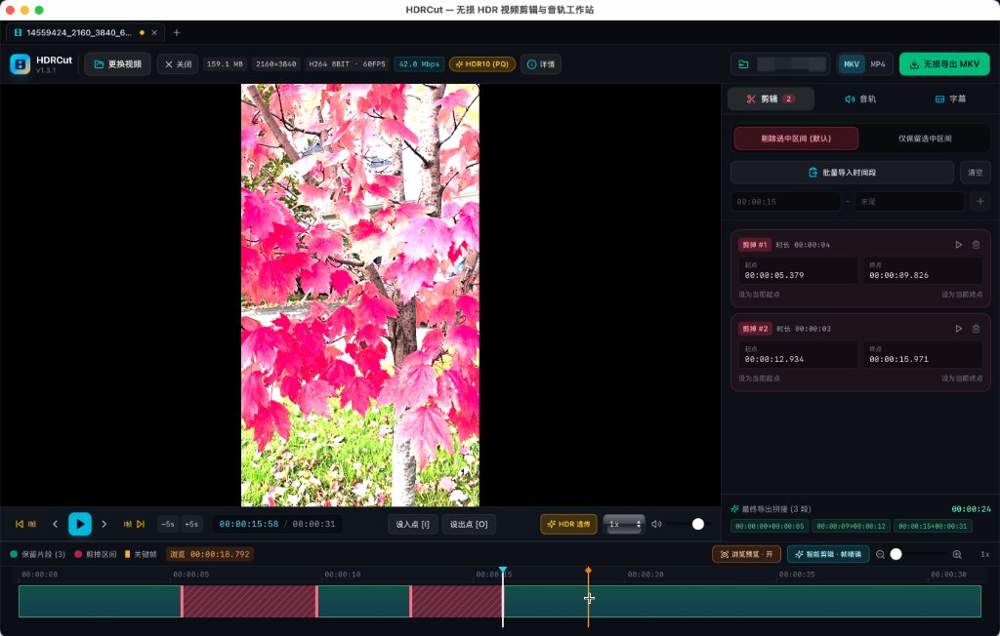
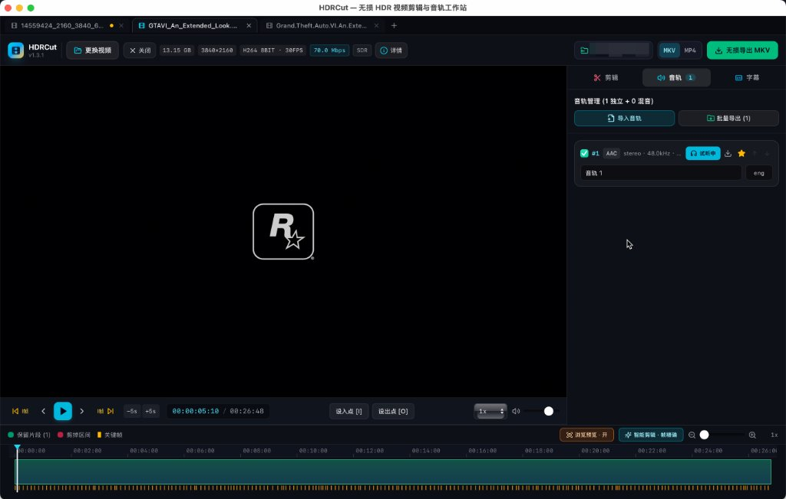
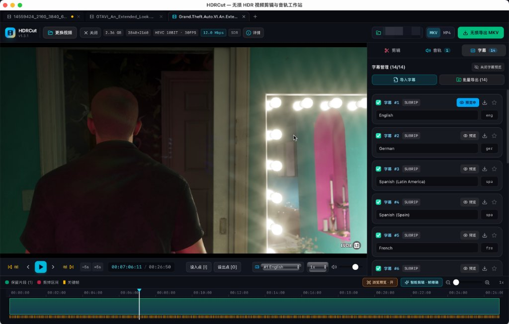
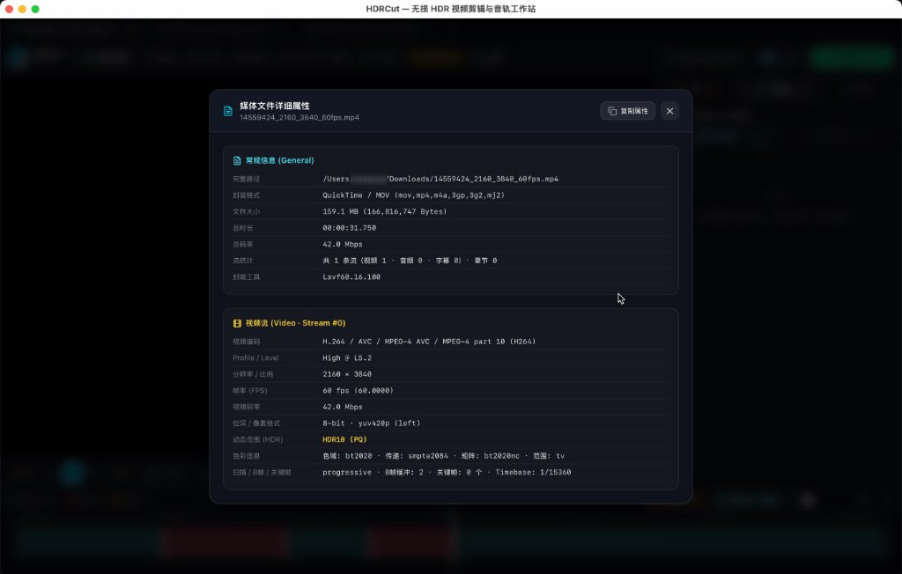
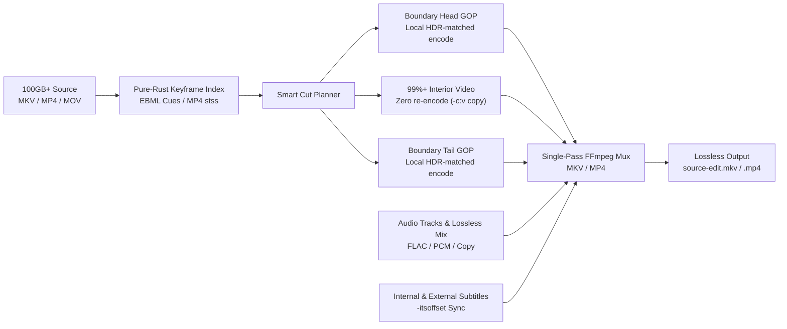

<div align="center">


# HDRCut

**Lightweight, ultra-smooth, blazing-fast lossless SDR & HDR video cutter.**

A sleek, native desktop workstation for standard **SDR** and 100GB+ 4K **HDR** videos. Instant
launch, buttery-smooth `libmpv` hardware-decoded preview, blazing-fast frame-accurate Smart Cut,
multi-track lossless audio mixing, subtitle workstation, bilingual UI, in-app auto-updates, and
isolated multi-tab editing — built with Tauri v2, Rust, and FFmpeg.

[](https://github.com/xzajyjs/HDRCut/releases)
[](LICENSE)
[](https://github.com/xzajyjs/HDRCut/actions/workflows/ci.yml)
[](https://github.com/xzajyjs/HDRCut/releases)
[](https://v2.tauri.app/)

**English** · [简体中文](README.zh-CN.md)

[Quick Start](#quick-start) · [Screenshots](#screenshots) · [How It Works](#how-it-works) · [Shortcuts](#keyboard-shortcuts) · [Development](#development) · [Changelog](CHANGELOG.md)

</div>

---

HDRCut is a **lightweight, ultra-smooth, blazing-fast** desktop video cutter and track
workstation engineered for both everyday **SDR** clips and massive **4K HDR (HDR10 / HLG / Dolby
Vision)** recordings (MKV / MP4 / MOV). Built natively on Rust + Tauri v2 with zero Electron
bloat, HDRCut opens 100GB+ files in seconds, scrubs at 60fps via hardware-accelerated `libmpv`,
and exports frame-accurate lossless cuts in a single streaming pass.

- **Lightweight & instant — zero Electron bloat.** Native Rust backend + system WebView + Canvas
  2D timeline: tiny footprint, low memory usage, and instant startup even with multi-tab 4K
  projects.
- **Ultra-smooth SDR & HDR hardware preview.** Seamless 60fps scrubbing for both standard 8-bit
  SDR and 10-bit HDR10 / HLG / Dolby Vision — embedded `libmpv` with 64-bit float `CAOpenGLLayer`
  EDR passthrough on macOS Apple Silicon and native `HWND` / D3D11 `gpu-next` on Windows x64,
  with zero proxy generation.
- **Blazing-fast Smart Cut & zero-reencode export.** Cut at any frame: only the tiny boundary GOP
  (a few seconds) at non-keyframe cut points is locally re-encoded to match source codec/HDR
  metadata, while 99%+ of the video streams directly with `-c:v copy` at disk speed. Or toggle
  pure **Keyframe-Only** mode for 100% zero re-encoding.
- **Final Cut Pro–style timeline skimming.** Toggle live hover skimming (`S`) to preview frames
  under your cursor with an orange skimmer line while keeping the main playhead anchored, plus
  batch time-range import and `HH:MM:SS:FF` segmented jump input.
- **Complete audio & subtitle workstation.** Live track auditioning, UTF-8 renaming, single/batch
  track export & delete, multi-track lossless **FLAC** / PCM / ALAC / AAC mixing, external
  audio/subtitle import with preserved titles & language codes, and live + exported subtitle
  offset adjustment.
- **Isolated multi-tab workspace, EN/ZH UI & auto-updates.** Open multiple videos in independent
  tabs (`⌘T` / `⌘W` / `⌘1`–`⌘9`), switch between English & 简体中文 anytime, and stay up to date
  automatically via built-in GitHub self-updates.

---

## Screenshots

| HDR10 Smart Cut & Timeline Skimming | Multi-Tab & Audio Track Manager |
| :---: | :---: |
|  |  |

| Multi-Track Subtitle Preview & Batch Export | PotPlayer-Style Media Details Inspector |
| :---: | :---: |
|  |  |

---

## Quick Start

Download the latest self-contained build from **[GitHub Releases](https://github.com/xzajyjs/HDRCut/releases)** — `libmpv`, `ffmpeg`, and `ffprobe` are already bundled inside:

- **macOS (Apple Silicon `arm64`)**: `HDRCut-<version>-macos-arm64.dmg`
  - Drag `HDRCut.app` into `Applications`.
  - Since builds are ad-hoc signed, if macOS Gatekeeper warns on first launch, run:
    ```bash
    xattr -cr /Applications/HDRCut.app
    ```
- **Windows (`x64` Portable)**: `HDRCut-<version>-windows-x64-portable.zip`
  - Unzip to any folder and double-click `HDRCut.exe` (uses the built-in Windows 10/11 Edge WebView2 runtime).

---

## How It Works

### Fast Keyframe Indexing & Smart Cut Pipeline

To avoid waiting minutes on 100GB+ files, HDRCut parses MKV EBML `Cues` and MP4 `stss`/`stts`
atoms directly in pure Rust (`64-bit` offsets) before touching FFmpeg. During export, Smart Cut
splits each non-keyframe cut boundary cleanly while keeping the untouched interior stream-copied:



- **Timebase-locked stitching.** Boundary GOP clips match the source container timebase (e.g.
  `1/1000` for MKV, exact `video_track_timescale` for MP4/MOV) along with pixel format, color
  primaries, transfer characteristics (`smpte2084` / `arib-std-b67`), and mastering metadata.
- **No 100GB temp copies.** Interior video segments are read directly via FFmpeg `ffconcat`
  inpoint/outpoint directives in a single pass.
- **Format-aware track handling.** Automatically preserves UTF-8 track titles, converts `mov_text`
  ↔ `srt` when crossing MKV/MP4 boundaries, and applies `-itsoffset` on external subtitles so
  exports match live `mpv` preview identically.

---

## Keyboard Shortcuts

| Shortcut | Action |
| --- | --- |
| `Space` | Play / Pause |
| `←` / `→` | Seek backward / forward 5s |
| `Shift + ←` / `Shift + →` | Jump to previous / next keyframe |
| `,` / `.` | Step previous / next single frame |
| `I` / `O` | Mark In / Mark Out (uses live skimmed frame when skimming) |
| `S` | Toggle Final Cut Pro–style Timeline Skimming |
| `⌘T` / `Ctrl+T` | Open new tab |
| `⌘W` / `Ctrl+W` | Close active tab |
| `⌘1`–`⌘9` / `Ctrl+1`–`Ctrl+9` | Switch to tab 1–9 (or last tab on `9`) |
| `⌘⇧[` / `⌘⇧]` or `Ctrl+Tab` | Previous / Next tab |
| `⌘O` / `Ctrl+O` | Import video file |

---

## Development

### Prerequisites

- **Node.js** >= 20 and **pnpm** >= 9
- **Rust** stable toolchain (`rustup`)
- **macOS**: `brew install mpv ffmpeg`
- **Windows**: MSVC Build Tools + `libmpv-2.dll`, `ffmpeg.exe`, `ffprobe.exe` (auto-fetched by `scripts/fetch-windows-deps.sh`)

### Run Locally

```bash
git clone https://github.com/xzajyjs/HDRCut.git
cd HDRCut
pnpm install
npx @tauri-apps/cli@2 dev
```

### Build & Test

```bash
# Run Rust unit tests & frontend type-check/build
cargo test --manifest-path src-tauri/Cargo.toml
pnpm build

# Build self-contained macOS Apple Silicon .app
pnpm build:mac

# Cross-compile Windows x64 portable bundle from macOS (requires cargo-xwin)
pnpm build:win
```

---

## License & Third-Party Notices

- HDRCut source code is licensed under the **[MIT License](LICENSE)**.
- Self-contained release bundles include third-party runtime binaries governed by their respective
  licenses: **[FFmpeg](https://ffmpeg.org/legal.html)** (LGPL / GPL) and
  **[libmpv](https://github.com/mpv-player/mpv/blob/master/Copyright)** (LGPL / GPL).
