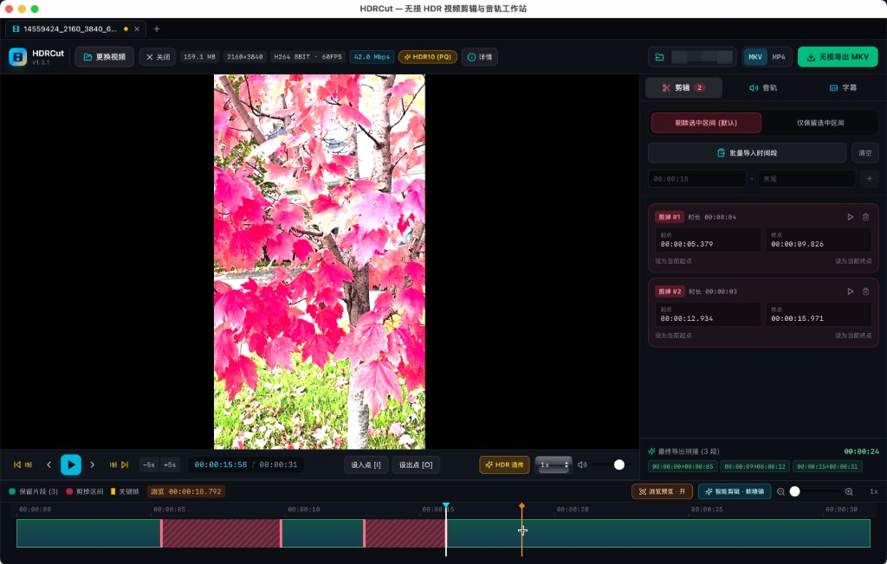
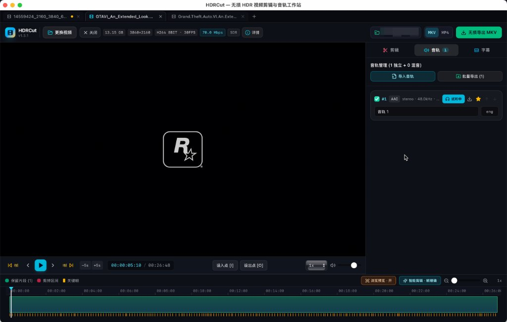
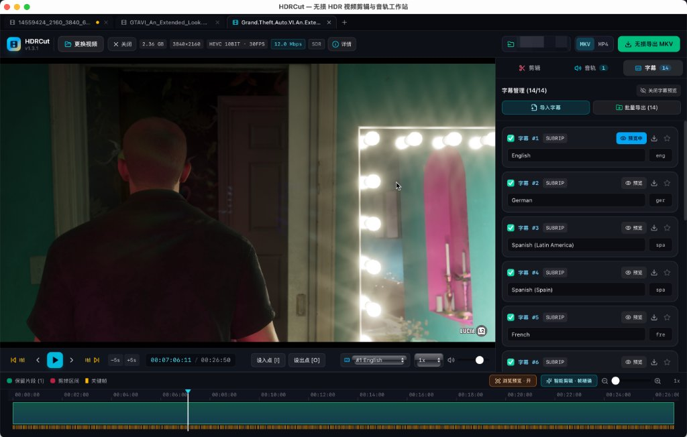
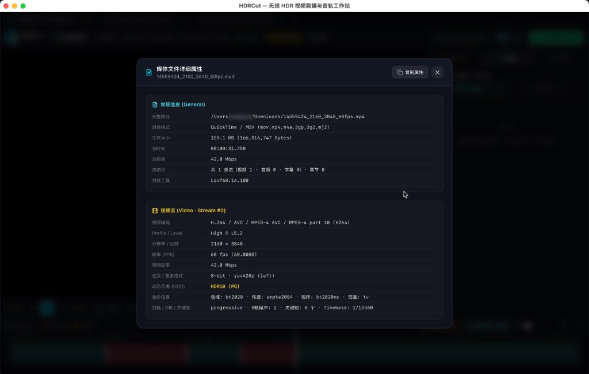
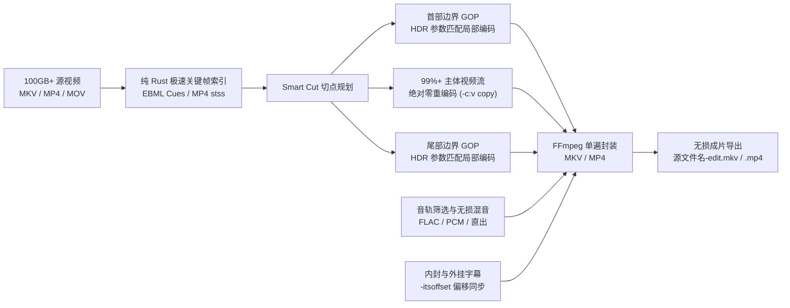

<div align="center">


# HDRCut

**每一比特都不妥协的无损 HDR 视频剪辑工作站。**

专为 100GB+ 4K HDR 大文件打造的跨平台桌面端视频剪辑与音轨/字幕工具。基于 Tauri v2、Rust、
原生内嵌 `libmpv` 硬解引擎与 `FFmpeg` 构建，支持真 HDR 流畅预览、智能帧精确剪辑（Smart Cut）、
多音轨无损混音、多字幕管理偏移与多标签页独立工作区。

[](https://github.com/xzajyjs/HDRCut/releases)
[](LICENSE)
[](https://github.com/xzajyjs/HDRCut/actions/workflows/build-release.yml)
[](https://github.com/xzajyjs/HDRCut/releases)
[](https://v2.tauri.app/)

[English](README.md) · **简体中文**

[快速开始](#快速开始) · [界面预览](#界面预览) · [工作原理](#工作原理) · [快捷键](#快捷键一览) · [本地开发](#本地开发与构建) · [更新日志](CHANGELOG.md)

</div>

---

HDRCut 面向超大容量 **4K HDR10 / HLG / Dolby Vision** 视频文件（MKV / MP4 / MOV）而设计。
无需全片重编码，也不用忍受 10 秒关键帧间隔带来的剪辑误差：秒级索引百 GB 视频关键帧、
原生硬解直出真 HDR 画面，并通过单遍流拷贝直接导出帧精确成片。

- **真 HDR 原生硬解预览**：macOS Apple Silicon 采用内嵌 `libmpv` + 64-bit float
  `CAOpenGLLayer` EDR 直通渲染；Windows x64 采用原生子窗口 `HWND` + D3D11 `gpu-next`
  硬件加速，百 GB 原盘秒开不卡顿。
- **Smart Cut 智能帧精确剪辑与零重编码导出**：支持任意帧精确切点，仅对非关键帧切点处
  1 个极短边界 GOP 匹配原片编码与 HDR 元数据局部重编码，其余 99%+ 画面保持 `-c:v copy`
  单遍直出；也可一键切换「仅关键帧 · 0 重编码」模式。
- **Final Cut Pro 风格时间轴浏览预览（Skimming）**：一键开启（快捷键 `S`），鼠标划过时间轴即以橙色浏览线实时预览对应画面，同时保持青色主播放头不动；支持批量文本导入时间段与 `时:分:秒:帧` 分段跳转。
- **全功能音轨与字幕工作站**：支持音轨实时切换试听、UTF-8 中文重命名、多轨无损 **FLAC** /
  PCM / ALAC / AAC 混音、单条/批量无损提取、外部音轨/字幕导入，以及外挂字幕前后时间偏移（预览与导出实时同步）。
- **多标签页独立工作区**：支持同时打开多个视频标签页（`⌘T` / `⌘W` / `⌘1`–`⌘9`），每个标签页的剪辑区间、音轨混音、字幕偏移、播放进度与导出配置完全隔离。

---

## 界面预览

| HDR10 智能剪辑与时间轴浏览预览 | 多标签页与音轨管理工作区 |
| :---: | :---: |
|  |  |

| 多字幕实时预览与批量导出 | PotPlayer 风格媒体详细属性面板 |
| :---: | :---: |
|  |  |

---

## 快速开始

前往 **[GitHub Releases](https://github.com/xzajyjs/HDRCut/releases)** 下载对应平台的自包含成品包（均已内置 `libmpv`、`ffmpeg` 与 `ffprobe`，无需额外安装依赖）：

- **macOS（Apple Silicon `arm64`）**：`HDRCut-<version>-macos-arm64.dmg`
  - 打开镜像将 `HDRCut.app` 拖入「应用程序（Applications）」。
  - 由于安装包使用本地临时签名，若首次打开触发系统安全拦截，在终端执行一次：
    ```bash
    xattr -cr /Applications/HDRCut.app
    ```
- **Windows（`x64` 绿色便携版）**：`HDRCut-<version>-windows-x64-portable.zip`
  - 解压至任意目录，双击运行 `HDRCut.exe` 即可（依赖 Windows 10/11 自带的 Edge WebView2 运行时）。

---

## 工作原理

### 极速关键帧索引与 Smart Cut 单遍流水线

为了避免在 100GB+ 文件上长时间等待，HDRCut 先通过纯 Rust 64 位解析器直接读取 MKV EBML
`Cues` 或 MP4 `stss`/`stts` 表秒级获取全部关键帧；导出时 Smart Cut 仅对边界极短 GOP
做参数匹配重编码，主体片段全程零拷贝直出：



- **严格时间基对齐**：边界重编码片段自动匹配源容器时间基（MKV `1/1000`、MP4/MOV 精确
  `video_track_timescale`）及像素格式、色域、传递特性（`smpte2084` / `arib-std-b67`）与 HDR
  母带元数据，拼接无跳帧无花屏。
- **不产生百 GB 临时文件**：主体视频片段通过 FFmpeg `ffconcat` 指令直接按区间单遍流拷贝。
- **跨封装智能兼容**：自动保留 UTF-8 中文轨道名，跨 MKV/MP4 导出时自动处理 `mov_text` ↔ `srt`
  字幕转换，并对外挂字幕施加 `-itsoffset` 确保导出与预览完全一致。

---

## 快捷键一览

| 快捷键 | 功能 |
| --- | --- |
| `Space` | 播放 / 暂停 |
| `←` / `→` | 后退 / 前进 5 秒 |
| `Shift + ←` / `Shift + →` | 跳转至上一个 / 下一个关键帧 |
| `,` / `.` | 上一帧 / 下一帧步进 |
| `I` / `O` | 设置入点 / 出点（浏览预览开启时直接标记当前屏幕浏览帧） |
| `S` | 开启 / 关闭 Final Cut Pro 风格时间轴「浏览预览（Skimming）」 |
| `⌘T` / `Ctrl+T` | 新建标签页 |
| `⌘W` / `Ctrl+W` | 关闭当前标签页 |
| `⌘1` ～ `⌘9` / `Ctrl+1` ～ `Ctrl+9` | 快速切换至第 1～9 个（或最后一个）标签页 |
| `⌘⇧[` / `⌘⇧]` 或 `Ctrl+Tab` | 切换上一个 / 下一个标签页 |
| `⌘O` / `Ctrl+O` | 导入视频文件 |

---

## 本地开发与构建

### 环境要求

- **Node.js** >= 20 与 **pnpm** >= 9
- **Rust** stable 工具链
- **macOS**：`brew install mpv ffmpeg`
- **Windows**：MSVC Build Tools + `libmpv-2.dll`、`ffmpeg.exe`、`ffprobe.exe`（可通过 `scripts/fetch-windows-deps.sh` 自动获取）

### 启动开发模式

```bash
git clone https://github.com/xzajyjs/HDRCut.git
cd HDRCut
pnpm install
npx @tauri-apps/cli@2 dev
```

### 测试与打包

```bash
# 运行 Rust 单元测试与前端类型检查/构建
cargo test --manifest-path src-tauri/Cargo.toml
pnpm build

# 构建自包含 macOS Apple Silicon .app
pnpm build:mac

# 从 macOS 交叉编译 Windows x64 便携包（需安装 cargo-xwin）
pnpm build:win
```

---

## 开源协议与第三方声明

- HDRCut 源代码采用 **[MIT License](LICENSE)** 许可协议。
- 发行包内置的运行时二进制依赖分别遵循其各自开源协议：**[FFmpeg](https://ffmpeg.org/legal.html)**（LGPL / GPL）与 **[libmpv](https://github.com/mpv-player/mpv/blob/master/Copyright)**（LGPL / GPL）。
